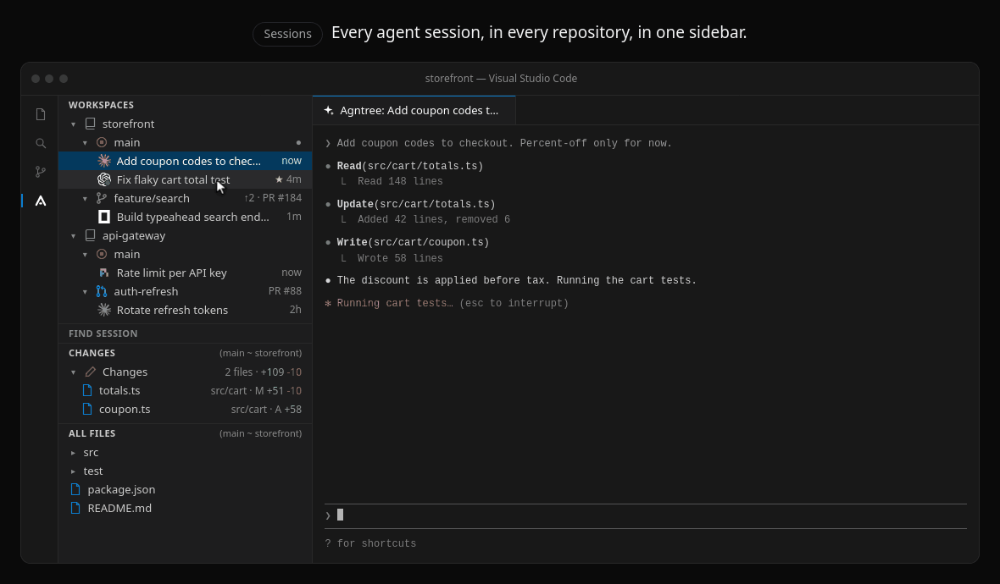
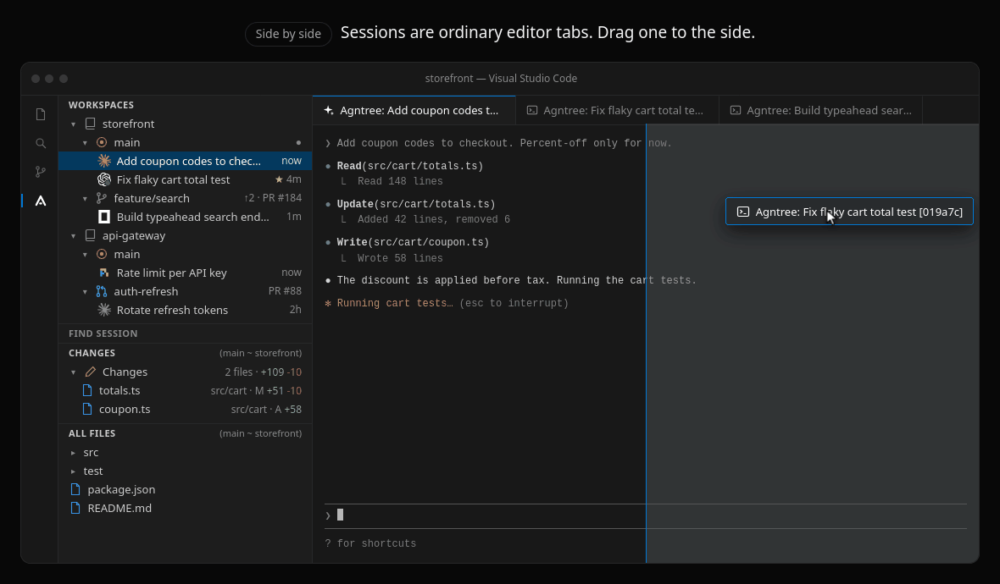
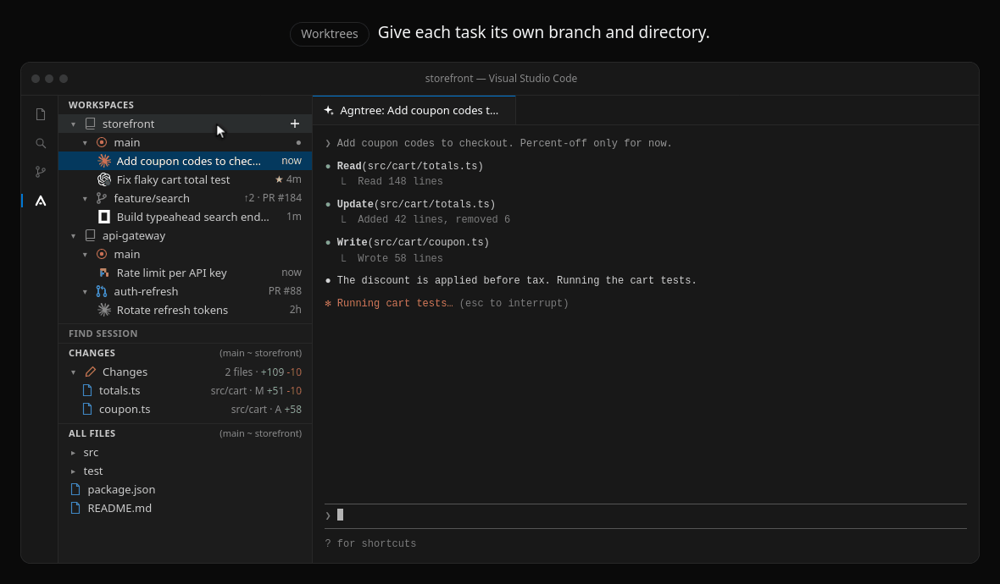
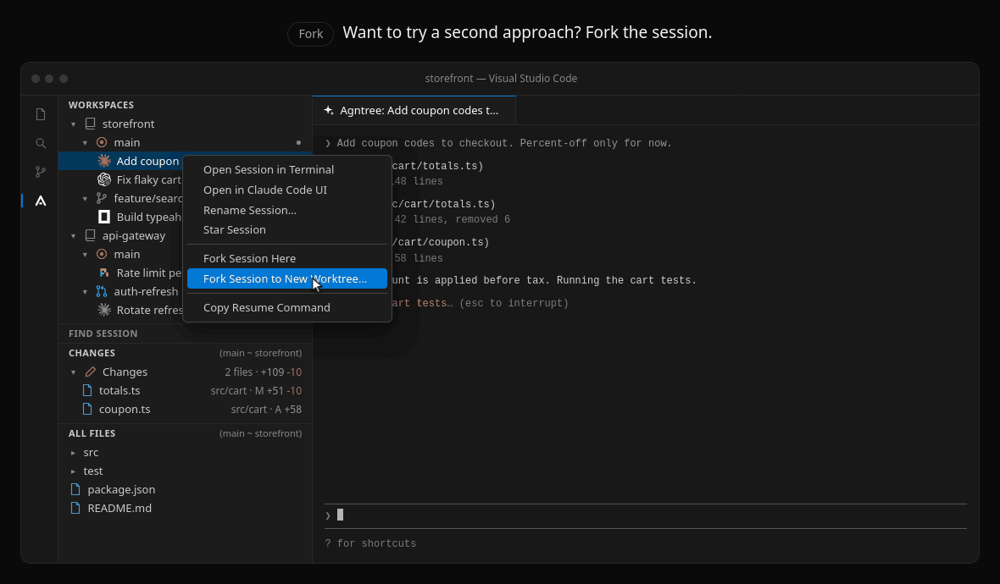
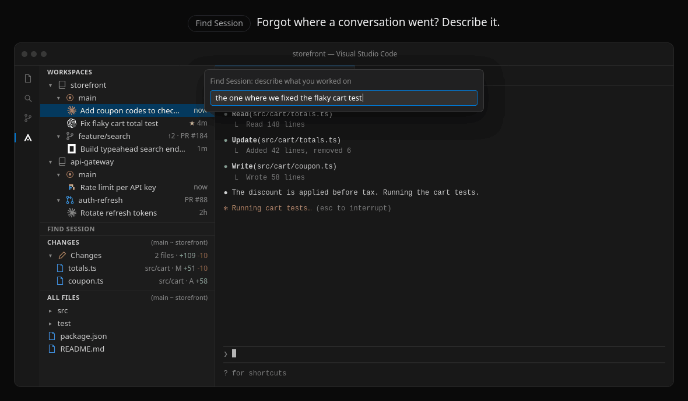
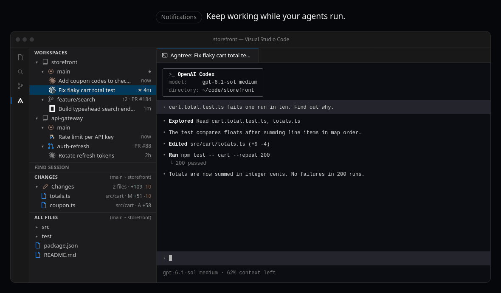
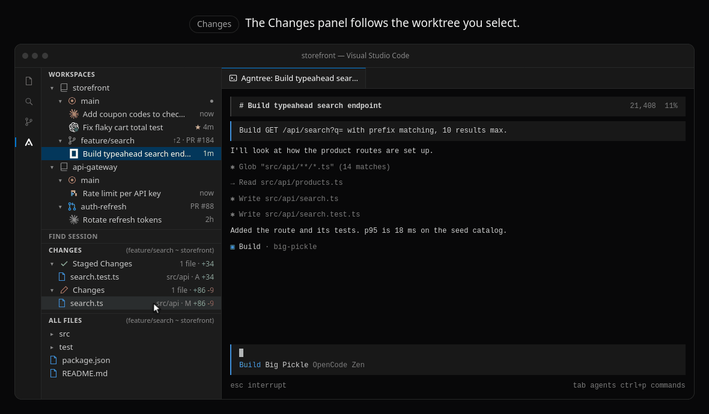
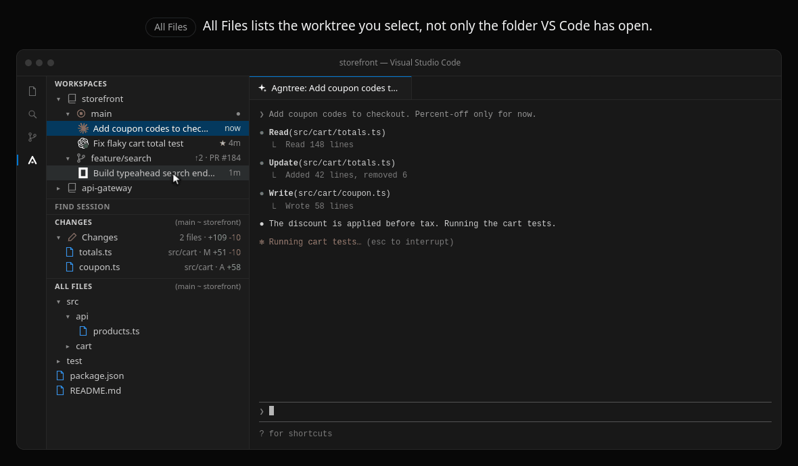
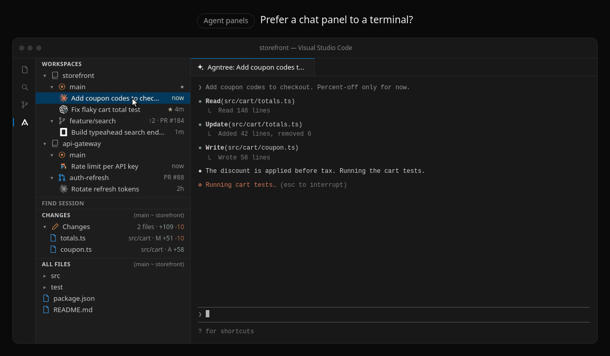

# Agntree: session and git worktree manager for Claude Code, Codex, opencode, and Pi

**Run every coding agent without leaving VS Code.** Agntree is a free, open-source extension for VS Code and Cursor that puts your Claude Code, Codex, opencode, and Pi sessions in one sidebar, grouped by repository and git worktree. Run agents in parallel, resume any conversation with one click, fork it to try another approach, and know the moment an agent needs you. There is no separate app to install and no second window to keep an eye on.

[](https://marketplace.visualstudio.com/items?itemName=subhashkhileri.agntree)
[](https://marketplace.visualstudio.com/items?itemName=subhashkhileri.agntree)
[](https://github.com/subhashkhileri/agntree/blob/main/LICENSE)
[](https://github.com/subhashkhileri/agntree)

[**Website**](https://subhashkhileri.github.io/agntree/) · [**Install**](https://marketplace.visualstudio.com/items?itemName=subhashkhileri.agntree) · [**Documentation**](https://subhashkhileri.github.io/agntree/docs/) · [**Getting started**](https://subhashkhileri.github.io/agntree/docs/getting-started/) · [**Changelog**](https://subhashkhileri.github.io/agntree/changelog/)



See more at **[subhashkhileri.github.io/agntree](https://subhashkhileri.github.io/agntree/)**.

## Why Agntree

One agent in one terminal is easy. The trouble starts at three.

- **Which terminal was that?** Five agents in five terminals, and you are the one holding the map of which is doing what.
- **Sessions go missing.** Resuming yesterday's conversation means remembering an ID, or scrolling a picker from the right directory.
- **Agents collide.** Two agents editing the same checkout overwrite each other's work.
- **You find out late.** One agent sat at a permission prompt for twenty minutes while you watched another.

Most tools that manage agents are a separate desktop app: another install, another window, another set of shortcuts. You already spend the day in your editor, so Agntree is an extension instead. Your theme, extensions, keybindings, and terminal stay as they are, and the diff of what an agent changed opens where you would fix it. No account, no telemetry.

## Install

Search for **Agntree** in the VS Code Extensions view, or run:

```bash
code --install-extension subhashkhileri.agntree
```

In Cursor, search for **Agntree** in the Extensions view; if it is not listed, install the `.vsix` from the [latest release](https://github.com/subhashkhileri/agntree/releases/latest).

Then select the Agntree icon in the Activity Bar, choose **Add Local Folder or Repository…**, and select **+** on a worktree to start a session. The [getting started guide](https://subhashkhileri.github.io/agntree/docs/getting-started/) walks through it in two minutes.

**Requirements:** VS Code 1.93 or newer (or Cursor), git, and at least one of the agent CLIs below. The GitHub CLI (`gh`) is optional and enables pull request checkout.

## Features

### All your sessions, next to the code

Every Claude Code, Codex, opencode, and Pi session sits under its repository and git worktree, across as many repositories as you add. Click one and the agent's own CLI opens with the right session ID in the right directory.

A session opens as an ordinary editor tab, so you can drag it, split it, and put two agents side by side like any two files.

- Sessions started anywhere (a plain terminal, another window, the agent's own panel) appear by themselves.
- Sessions are named by the agent, can be renamed by you, and can be starred to keep them.
- A mark on each row shows whether the agent is working, finished, closed, or new.



[How sessions work →](https://subhashkhileri.github.io/agntree/docs/sessions/)

### Run agents in parallel on git worktrees

Give each task its own branch and its own directory, so agents never edit the same files. Create a worktree from an existing branch, a new branch, or a GitHub pull request, and start an agent in it.

- Repository to worktree to running agent in three clicks.
- Ahead and behind counts and the pull request number on every branch.
- Merge, rebase, and delete worktrees without leaving the sidebar.



[Run agents in parallel →](https://subhashkhileri.github.io/agntree/docs/guides/parallel-agents-git-worktrees/)

### Fork the conversation, not just the branch

Try a second approach without giving up the first. A fork keeps the whole conversation, so the agent carries on with everything it has already learned.

- **Fork Session Here** continues beside the original.
- **Fork Session to New Worktree…** also creates a branch and brings your uncommitted changes.



[Fork a session →](https://subhashkhileri.github.io/agntree/docs/fork-sessions/)

### Find any session by describing it

Type "the one where we fixed the flaky cart test". Find Session has an agent search your history across every agent and every folder on your machine, then checks each match against the agent's own records before showing it. The searching agent gets read-only tools, and there is no index to build.



[Find Session →](https://subhashkhileri.github.io/agntree/docs/find-session/)

### Know which agent needs you

Agntree notifies you when a turn finishes, and for Claude Code, when it is waiting on a permission prompt or a question. `Ctrl+Alt+N` (`Ctrl+Cmd+N` on macOS) jumps to the session that has waited longest.



[Notifications →](https://subhashkhileri.github.io/agntree/docs/notifications/)

### See exactly what the agent changed

The **Changes** panel follows the worktree you select: staged and unstaged files with line counts, and stage, unstage, and discard on each row. Click a file and its diff opens beside the agent, so you can review while it keeps working. **All Files** lets you browse and edit that worktree without switching windows.





[Changes and files →](https://subhashkhileri.github.io/agntree/docs/changes-and-files/)

### Terminal or panel, your choice

Open a session in its terminal, or hand it to the Claude Code or Codex extension's chat panel and back. Agntree closes one side before opening the other, so two processes never write to the same session.



[Agent panels →](https://subhashkhileri.github.io/agntree/docs/agent-panels/)

## Supported agents

| Agent | Start and resume | Fork | Auto-import | Find Session | Notifications | VS Code panel |
| --- | :-: | :-: | :-: | :-: | --- | --- |
| [Claude Code](https://subhashkhileri.github.io/agntree/docs/agents/claude-code/) | ✓ | ✓ | ✓ | ✓ | Finished turns and "needs input" | ✓ |
| [Codex](https://subhashkhileri.github.io/agntree/docs/agents/codex/) | ✓ | ✓ | ✓ | ✓ | Finished turns | ✓ |
| [opencode](https://subhashkhileri.github.io/agntree/docs/agents/opencode/) | ✓ | ✓ | ✓ | Searched | Finished turns | Terminal only |
| [Pi](https://subhashkhileri.github.io/agntree/docs/agents/pi/) | ✓ | ✓ | ✓ | ✓ | Finished turns | Terminal only |

Claude Code needs version 2.1.310 or newer, and opencode version 2 or newer. Mix agents freely: a Claude Code session and a Codex session can sit under the same branch.

Each agent keeps its own sessions. Agntree reads them through the interface that agent supports and copies nothing into a format of its own, so every session still resumes from the command line with Agntree closed or uninstalled.

## Agntree, or doing it by hand

| Task | By hand | With Agntree |
| --- | --- | --- |
| Resume a session | Find the ID, `cd` to its directory, run `claude --resume <id>`, `codex resume <id>`, `opencode --session <id>`, or `pi --session <id>` | Click the session |
| Start an agent on a new branch | `git worktree add`, `cd`, start the CLI, remember which terminal it is | **Create Worktree…**, then **+** |
| Try a second approach | Learn each agent's fork flags and where the copy lands | **Fork Session Here** |
| Find last week's session | Grep transcripts, or scroll a picker in every directory | Describe it in **Find Session** |
| Notice an agent is waiting | Look at each terminal in turn | A notification, or `Ctrl+Alt+N` |
| Review the agent's edits | `git status` and `git diff`, again and again | The **Changes** panel |
| Work on a pull request | Fetch the branch, add a worktree, `cd`, start the CLI | **Check Out Pull Request…** |

Standalone apps such as Orca and Paseo run agents in a separate desktop app. Agntree is an extension, so your agents stay beside the editor, extensions, and keybindings you already use. See the [comparison](https://subhashkhileri.github.io/agntree/docs/comparison/).

## Keyboard shortcuts

| Windows and Linux | macOS | Action |
| --- | --- | --- |
| `Ctrl+Alt+Enter` | `Ctrl+Cmd+Enter` | New session with your default agent, in the current worktree |
| `Ctrl+Alt+N` | `Ctrl+Cmd+N` | Go to the next session that needs you |
| `Ctrl+Alt+F` | `Ctrl+Cmd+F` | Find Session… |
| `Ctrl+Alt+S` | `Ctrl+Cmd+S` | Starred Sessions… |
| `Ctrl+Alt+A` | `Ctrl+Cmd+A` | Show the Agntree sidebar |

Every shortcut can be changed. See [all keyboard shortcuts](https://subhashkhileri.github.io/agntree/docs/reference/keyboard-shortcuts/).

## FAQ

**Is Agntree free?**
Yes. Agntree is MIT licensed and free. You pay only what your agents already cost you.

**Does Agntree work in Cursor?**
Yes. It works in VS Code 1.93 or newer and in editors built on it, such as Cursor. If your editor's extension search does not list Agntree, install the `.vsix` from the [latest release](https://github.com/subhashkhileri/agntree/releases/latest).

**Does Agntree send my code or sessions anywhere?**
No. Agntree makes no network requests of its own and collects no telemetry. Find Session is the one feature that sends session text to a model, through the agent you choose, and only when you ask it a question. See [privacy](https://subhashkhileri.github.io/agntree/docs/privacy/).

**What happens to my sessions if I uninstall it?**
Nothing. Sessions stay in each agent's own storage with their own IDs.

**Does it work on Windows?**
Partly. Agntree is developed and tested on macOS and Linux, and commands it types into a terminal are quoted for POSIX shells.

More in the [full FAQ](https://subhashkhileri.github.io/agntree/docs/faq/) and [troubleshooting](https://subhashkhileri.github.io/agntree/docs/troubleshooting/).

## Documentation

- [Getting started](https://subhashkhileri.github.io/agntree/docs/getting-started/)
- Features: [sessions](https://subhashkhileri.github.io/agntree/docs/sessions/), [worktrees](https://subhashkhileri.github.io/agntree/docs/worktrees/), [forking](https://subhashkhileri.github.io/agntree/docs/fork-sessions/), [Find Session](https://subhashkhileri.github.io/agntree/docs/find-session/), [notifications](https://subhashkhileri.github.io/agntree/docs/notifications/), [agent panels](https://subhashkhileri.github.io/agntree/docs/agent-panels/), [changes and files](https://subhashkhileri.github.io/agntree/docs/changes-and-files/)
- Guides: [run agents in parallel with git worktrees](https://subhashkhileri.github.io/agntree/docs/guides/parallel-agents-git-worktrees/), [resume a session](https://subhashkhileri.github.io/agntree/docs/guides/resume-a-session/)
- Reference: [settings](https://subhashkhileri.github.io/agntree/docs/reference/settings/), [commands](https://subhashkhileri.github.io/agntree/docs/reference/commands/), [keyboard shortcuts](https://subhashkhileri.github.io/agntree/docs/reference/keyboard-shortcuts/)

The same pages are in [`docs/`](https://github.com/subhashkhileri/agntree/tree/main/docs) as Markdown.

## Contributing

Agntree is built in the open, and adding an agent is one adapter. Read [CONTRIBUTING.md](https://github.com/subhashkhileri/agntree/blob/main/CONTRIBUTING.md) to set up, and [ARCHITECTURE.md](https://github.com/subhashkhileri/agntree/blob/main/ARCHITECTURE.md) for how it works. Bugs and ideas go in [issues](https://github.com/subhashkhileri/agntree/issues).

If Agntree saves you time, a [star on GitHub](https://github.com/subhashkhileri/agntree) or a [Marketplace review](https://marketplace.visualstudio.com/items?itemName=subhashkhileri.agntree&ssr=false#review-details) helps other people find it.

## License

[MIT](https://github.com/subhashkhileri/agntree/blob/main/LICENSE)
